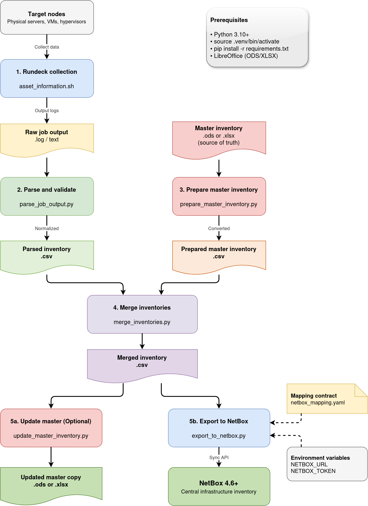

# Architecture and Data Flow

This document describes the general architecture of the **Datacenter Inventory Pipeline**, the data model that supports it, and the design decisions behind each stage.

---

## Overview

The pipeline follows a linear and deterministic ETL (Extract, Transform, Load) sequence:

```text
Rundeck (Nodes) → Shell Script → Log → Parser → Parsed CSV
                                                     ↓
                         Master Sheet (ODS/XLSX) → Prepared CSV
                                                     ↓
                                              Consolidated CSV (Merge)
                                                     ↓
                                                  NetBox (API)
```



The diagram source file (`inventory_pipeline.drawio`) is located in `docs/assets/`.

### Orchestration

The orchestrator `inventory_pipeline.run_pipeline` (console command `inventory-pipeline`) executes the stages in order, reading the job output and the master spreadsheet from `input/` and writing every artifact to `output/`. It is **fail-fast**: the first stage that exits with a non-zero code stops the pipeline and its code becomes the pipeline's exit code. The export always runs twice: first with `--dry-run`, then (after an interactive confirmation, or `--yes`) for real. The optional master write-back (`--update-master`) runs last and only after a successful real export, so the updated copy always matches what NetBox holds.

Stages run as subprocesses rather than in-process calls: each stage terminates through `sys.exit()` on validation errors, and the exporter configures logging at module level. Isolating them keeps each stage's behavior identical to a manual run.

---

## UUID Merge Model

The **inventory UUID** (`inventory_uuid`) is the master key that connects all stages of the pipeline. It is extracted directly from the node's hardware/BIOS using the Bash collection script and remains intact throughout the entire flow.

### Merge Rules (Consolidation)

The [`rundeck_header_list.txt`](../config/rundeck_header_list.txt) file defines the column contract and update rules using numeric flags:

| Flag | Behavior | Example |
| ------ | --------------- | --------- |
| `0` | **Preserve** the master value. It is never overwritten. | Manual columns (Rack, Role) |
| `1` | **Update** if the parsed value is not empty. | Dynamic data (OS, CPU, RAM) |
| `2` | **Merge key**. Exactly one must exist. | `UUID` |

The merge key is currently the machine UUID. Parsers resolve columns by name, so the column order does not need to match.

### UUID Normalization

To guarantee the idempotency of the synchronization with NetBox, the pipeline normalizes all UUIDs to **lowercase** before any comparison or submission to the API. This prevents duplicates caused by capitalization differences between sources.

---

## Idempotency

The pipeline is designed to be executed repeatedly with the same input without generating side effects:

- **Merge**: Rows with invalid or duplicate keys are excluded from the merge, preserving the integrity of the master.
- **NetBox Export**: The synchronization identifies existing records by UUID (primary) or by name (fallback). Only fields that actually changed are updated. Records without changes are silently skipped.
- **Dry-Run**: All destructive operations support `--dry-run` for prior inspection.

---

## NetBox Synchronization Flow

The exporter follows this logic for each row in the CSV:

Malformed CSV records are handled at read time: a record with **fewer** fields than the header is padded with empty values (with a warning), while one with **more** fields (typically an unquoted comma shifting the columns) is discarded and counted as an error, since its values could land in the wrong column.

Rows are identified in logs by the physical CSV line where they start (not by list position), so messages stay accurate with multi-line cells.

1. **Identity resolution (two stages)**:
   1. **By UUID**: searches NetBox by `inventory_uuid` (exact match) and requires the UUID to be unique, i.e. it appears exactly once in the CSV and on exactly one NetBox object. If so, that object is synchronized.
   2. **By name** (only if the UUID stage does not resolve the row: empty, not found, or duplicated in the CSV or NetBox): searches by machine name **within the configured Site** (NetBox names are only unique per Site, so a same-named node in another Site is a different node and is never touched).

   The UUID is a global identity, so it is searched across all Sites. If it belongs to a node of a *different* Site, the row is skipped with a `WARNING` instead of moving or duplicating that node.
2. **Uniqueness validation**: Uniqueness is counted only over CSV rows with a valid `machine_type` (rows discarded as invalid are not synchronized, so they cannot make another row ambiguous). A name match requires the name to be unique both in the CSV and in NetBox; otherwise the row is skipped. A name match is also skipped when the existing object already carries a *different* non-empty `inventory_uuid` (the identity of another node is never overwritten). Rows that share a duplicated UUID therefore never overwrite each other: each one is resolved independently by its own name.
3. **Payload construction**: Fields are mapped according to the contract defined in `netbox_mapping.yaml`, applying casts and transformations.
4. **Change detection**: Compares the payload against the current state of the record. An update is only issued if there are actual differences.
5. **Dependency synchronization**: Sites, Manufacturers, Device Types, Platforms, Roles, Clusters, Custom Fields, Interfaces, Prefixes, and IPs are created or resolved as prerequisites. Each row is processed in three phases: (1) **validate** the row without writing (payload, casts, maps, role, status and DeviceType attributes), (2) **resolve its identity** (read-only), and only then (3) **write** the per-row dependencies (Platform, Location, Rack, Cluster, Manufacturer, DeviceType) and the node. A row that ends in `SKIP` or in a data `ERROR` therefore leaves nothing written in NetBox. The only exception is an API rejection of the final node create/update: NetBox has no multi-object transactions, so dependencies created for that row remain (they are reused on the next run).
6. **Interface renames**: If an interface disappears from the CSV under one name and a new one appears with the same IP (host, ignoring the mask) or the same MAC, the existing NetBox interface is **renamed** instead of creating a new one and pruning the old one (deleting an interface in NetBox also deletes its IPs and MACs). The match must be one-to-one and unambiguous: values shared by several interfaces (e.g. a bond and its members' MAC) are ignored, and contradicting signals skip the rename with a `WARNING`. Swapping names between two interfaces that exist on both sides is not detected.
7. **Shared IP handling**: NetBox does not allow the same IP on two interfaces (e.g. a node and its replica). An IP already assigned to another interface is skipped with a `WARNING` naming its owner, not counted as an error. The first node processed keeps the IP.
8. **Primary IP assignment**: If a Device or VM has exactly one valid IP, it is automatically assigned as the primary IPv4.

### Device Type Attributes (Model-Level Consolidation)

`Height (U)` and `P/N` belong to the **DeviceType**, which is shared by every device of the same manufacturer and model. To keep the export idempotent, they are consolidated **once per model** before synchronizing:

- **First non-empty value wins**, per attribute and in CSV order. Rows of the same model that disagree produce a `WARNING` with the CSV lines involved; the master inventory should be corrected.
- The DeviceType is written **at most once per run** with the consolidated values, so rows never overwrite each other and a re-run issues no updates.
- **Empty never overwrites**: an existing DeviceType keeps its height and P/N when the CSV does not inform them (protects manual P/N and 0U child types). A new DeviceType without height is created with `1.0U` (with a warning). `0` is an explicit, valid height.
- If NetBox **rejects** the update (e.g. switching to 0U while devices are racked, or growing the height without rack space), a `WARNING` is logged and the device is synchronized with the current DeviceType.
- Invalid values in a row (height not a multiple of `0.5`, negative, or P/N longer than 50 characters) make that row fail; they are ignored by the consolidation.

### Taxonomy Resolution & Slug Collisions (Fail-Fast vs. Fail-Safe)

NetBox mandates a URL-friendly `slug` for abstract taxonomy models (`Site`, `ClusterType`, `Manufacturer`, `DeviceType`, `DeviceRole`, `Platform`), but does not use slugs for physical instantiated objects (`Rack`, `Cluster`, `Device`, `VirtualMachine`).

When resolving or creating taxonomic dependencies, the pipeline adopts a dual strategy depending on the nature of the data:

- **Fail-Fast (Static Data):** For objects derived from the master configuration (`netbox_mapping.yaml`) like `Site` and `ClusterType`. If a collision occurs upon creation (e.g., trying to create a Site with a slug that already belongs to another Site), the pipeline throws a `NetBoxApiError` and aborts. Silently generating a fallback slug (e.g., `site-1a2b`) would create a duplicate organization and split the infrastructure incorrectly.
- **Fail-Safe (Dynamic Data):** For objects derived from unpredictable node hardware data like `Manufacturer`, `DeviceType`, and `DeviceRole`. Node data can be dirty (e.g., "HP" vs "H.P."). The pipeline first attempts to deduplicate by checking if the generated slug already exists. If an unavoidable collision happens during creation, it applies a deterministic fallback slug appended with a hash (e.g., `hp-c4d2`). This ensures the pipeline survives dirty data without stopping the execution.
